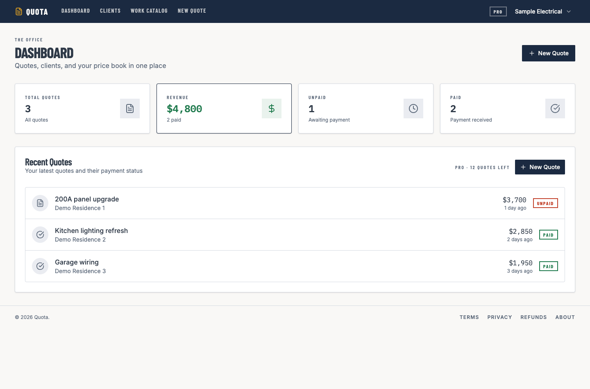
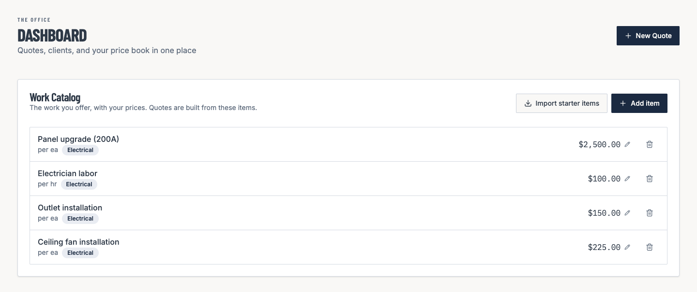
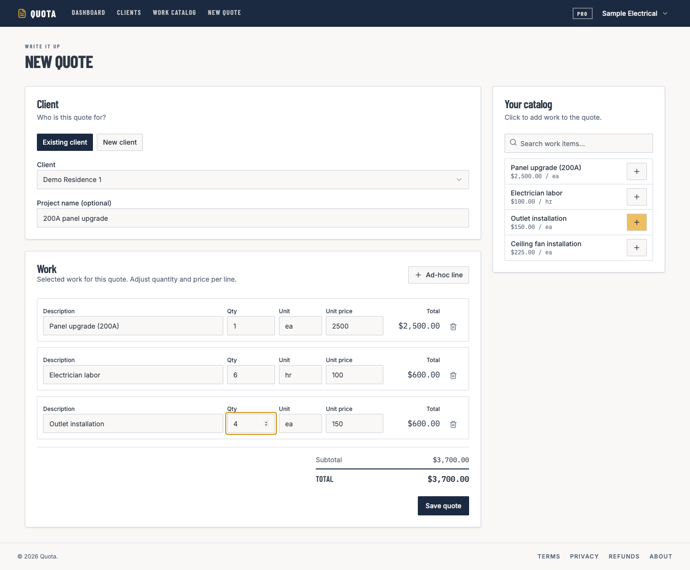

# Quota

**Less paperwork between explaining a job and sending a professional quote.**

Quota helps contractors organize their services and prices, create clear quotes and PDF invoices, and keep track of payments. Its next step is voice-to-quote: record what a job needs in your own words, then review a customer-friendly draft instead of typing each item on a phone.

## How AI would help

Imagine saying, “Replace four outlets and allow six hours of labor.” The planned workflow would:

1. Convert the recording into text.
2. Use AI to identify the work, quantities and customer mentioned in those notes.
3. Match the work to your saved price book and prepare an editable quote draft.
4. Let you check the customer, wording, quantities and prices before saving, exporting or emailing it.

Prices would come from your own catalog or your edits. You would approve the draft before it becomes a saved quote or invoice.

**Status:** voice capture and AI drafting are planned in the [voice-to-invoice design](docs/superpowers/specs/2026-08-08-voice-to-invoice-design.md). The current app supports catalog-based quoting, PDF invoices, email and payment records; the screenshots below show that existing workflow.

[See it in action](#see-it-in-action) · [Engineering highlights](#engineering-highlights) · [Run locally](#development) · [Security](SECURITY.md)

## See it in action

### 1. See what needs attention



The dashboard brings recent quotes, payment status and monthly plan usage together. All names, amounts and account details shown here are synthetic demo data.

<details>
<summary><strong>2. Keep a reusable price book</strong></summary>



Add your services and prices once, or import a trade starter catalog. Reuse them on the next quote.

</details>

<details>
<summary><strong>3. Build the quote from your catalog</strong></summary>



Choose a client, add catalog items, adjust quantities and prices, then save. Saved quotes support PDF export, invoice emails and payment records.

</details>

**Workflow:** price book → quote → PDF / email → payment record.
Client payments happen outside Quota; Stripe handles the contractor’s subscription.

## Engineering highlights

| Challenge | Approach | Explore |
| --- | --- | --- |
| Enforce monthly quote limits under concurrent requests | One database transaction creates the quote, dependent records and payment schedule | [Atomic migration](db/migrations/014_atomic_integrity_writes.sql) |
| Keep billing correct when events arrive late | Read current Stripe state and apply it only if the database revision still matches | [Billing synchronization](lib/billing-state.ts) · [Ordering tests](lib/__tests__/billing-state.test.ts) |
| Share request budgets across app instances | Service-only PostgreSQL counters with hashed identifiers | [Rate limiter](lib/rate-limit.ts) |
| Make changes reviewable | Unit tests, type-check, lint, production build and synthetic browser checks | [CI](.github/workflows/ci.yml) · [Database regressions](scripts/security-db.test.py) |

This is a curated source showcase. Setup requires your own local configuration; deployment prerequisites and remaining dependency limits are documented in [SECURITY.md](SECURITY.md).

## Tech Stack

- **Framework:** Next.js 16 (App Router), React 19, TypeScript (strict)
- **Styling:** Tailwind CSS + shadcn/ui
- **Database:** PostgreSQL via Supabase (service-role client)
- **Auth:** Auth0 (`@auth0/nextjs-auth0` v4) — `/auth/login` hands off to Auth0 Universal Login
- **Payments:** Stripe (in-app billing — Checkout/Portal-free) with Stripe Elements for card entry
- **Email:** Resend
- **PDF:** `@react-pdf/renderer`
- **Tests:** Vitest (unit, node-env) + Playwright (e2e)

## Core flow

```
Auth0 login → Dashboard (Quotes) — Clients & Work Catalog in the top nav
  → Work Catalog: import starter items by trade / add own / edit prices
  → New Quote: pick/create client (name, email, address) → add catalog items
    (+ ad-hoc lines) → subtotal = total (no tax) → save
  → Quote page: Send to client (email + PDF, Pro+) · Mark paid/unpaid ·
    record payments · email receipt (Pro+)
  → Plan & Billing (/billing): change plan · update card · invoices · cancel/reactivate
```

## Subscription tiers

| Tier | Price | Quotes / month | Email invoicing | Logo on PDF | Watermark |
|---|---|---|---|---|---|
| Free | $0 | 3 | — (export PDF) | — | "Made with Quota" |
| Pro | $15/mo | 15 | ✓ | ✓ | none |
| Ultimate | $29/mo | unlimited | ✓ | ✓ | none |

- Quotes are metered **per calendar month (UTC)** — enforced at create (`/api/quotes` 403) and reported in `/api/subscription`.
- **Email invoicing is Pro+** — the Free `Send` opens an upgrade prompt with a Download-PDF option; the server also 403s Free email sends.
- **Logo** renders on PDFs for Pro+ only; the **"Made with Quota"** footer shows on Free-tier PDFs only.
- **Clients are unlimited** on every tier.
- Subscription tiers are synchronized from live Stripe state by the webhook and scheduled reconciliation, using conditional database revisions to prevent stale writes.

## Billing (in-app, no Stripe-hosted pages)

`/billing` is the full billing center. Card entry uses **Stripe Elements** (SetupIntent) — no raw card touches the backend. Plan changes: **upgrades apply immediately (prorated); downgrades are scheduled to period end** via a Stripe subscription schedule; downgrade-to-free = cancel at period end. Cancel/reactivate flip `cancel_at_period_end`. Invoice history is fetched live from Stripe and rendered in-app.

## Development

```bash
npm run dev            # dev server on localhost:3000
npm run build          # production build
npm run type-check     # tsc --noEmit
npm run lint           # eslint
npm run test:e2e       # Playwright suite

# Local database (Supabase CLI in Docker)
supabase start         # API 127.0.0.1:54321, DB 54322
supabase db reset      # recreate schema and load synthetic fixtures
npm run db:link-seed   # optional: associate fixtures with your local Auth0 account
supabase status        # local keys/URLs

# Local Stripe webhook (required for tier sync in dev)
stripe login
stripe listen --forward-to localhost:3000/api/webhooks/stripe
# → paste the printed whsec_… into STRIPE_WEBHOOK_SECRET, restart dev
```

Use Node.js 22.12+ and install dependencies with `npm ci`. Copy [.env.example](.env.example) to `.env.local`, then configure your own Auth0, Supabase, Stripe and Resend accounts. Keep the filled file local. Review [SECURITY.md](SECURITY.md) before configuring a hosted deployment.

All seed contacts use reserved `example.invalid` mailboxes and fictional addresses.
To view seeded data after logging in, set `E2E_AUTH0_USER_ID` to your account
subject in `.env.local`, then run `npm run db:link-seed` after a local database
reset. This helper refuses hosted databases. Keep the service-role key and all
private operational values server-side; never use a `NEXT_PUBLIC_` prefix for them.


## Project docs

- [.env.example](.env.example) — configuration template
- [SECURITY.md](SECURITY.md) — deployment requirements, validation and dependency limits
- `docs/superpowers/specs/` + `docs/superpowers/plans/` — design specs and implementation plans per feature
- `openspec/changes/work-catalog-invoicing/` — the work-catalog PRD / design / tasks

## Testing note

Stripe test mode: use card `4242 4242 4242 4242` (any future expiry, any CVC, any ZIP). The Stripe **account balance shows $0 in test mode even after successful charges** — payments appear under Payments/Subscriptions, not Balance.

## Pre-deploy checklist

- Apply every migration to your own database, including the anonymous-access lockdown and the atomic quote, rate-limit and billing functions. Verify anonymous requests cannot read application data.
- Set Stripe to **live** keys + configure the production webhook endpoint.
- Ensure `ALLOW_DEV_TIER_SWITCH` is **not** set in production.
